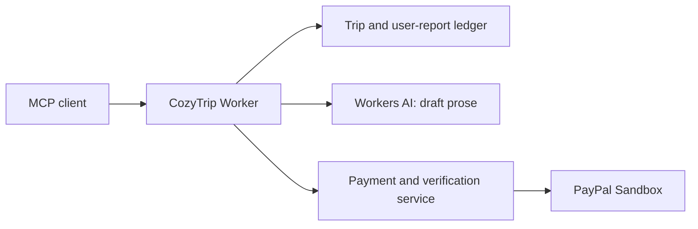

# CozyTrip

A remote MCP assistant that helps a group understand a fictional travel disruption, prepare after-sales requests, and request shared-expense payments using real PayPal Sandbox transactions. No production payments or automatic merchant actions are enabled.

## Hosted demo

**MCP URL:** https://mcp.cozytrip.dev/mcp
Transport: Streamable HTTP. Configure the header `Authorization: Bearer <judge token>` in MCP Inspector or another compatible MCP client.

The service uses per-user demo tokens; each identity has its own trip ledger. Travel participants Maya, Leo and Ava are fictional people in the sample, not MCP login accounts.

<!-- JUDGE_ACCESS_START -->
Judge tokens expire **2026-12-16 00:00 UTC**. Use one per judge; all are scoped to this fictional Sandbox demo.

- Judge A: `ehD_nol6MdeYYARGRsqG_K5fmdJu0iMQsh8NjV15Crk`
- Judge B: `ENJDl_9Z9SqVcrjE5GM9rQCYZp-M238vUjJdh3M3XPo`
- Judge C: `MDfQ7-lTU2eEuV3XLg-36OLlJOJnxgGXbnAoJ7RYtJA`

Judge A is used for the release pre-payment acceptance check; choose B or C for an untouched empty ledger. No judge payment is performed during release acceptance.
<!-- JUDGE_ACCESS_END -->

**Judge Sandbox buyers — Tim must fill these before submission:**
- Service fee buyer: `<<TIM: judge buyer email/password>>`
- AA buyer: `<<TIM: second judge buyer email/password>>`

Use dedicated judge-only Sandbox buyers. The team’s personal test-account credentials are not included. This project uses Sandbox only; do not use a real PayPal account or payment card.

## Judge path: six steps, about five minutes

1. Connect MCP Inspector to the hosted MCP URL using a judge Bearer token. Call `get_status`: a fresh identity has no trip, payment or case.
2. Call `import_orders` with `{ "mode": "sample" }`, then `reconcile_trip` with its `trip_id`. Four source bookings total USD 1,491.00; the source prepaid pickup is USD 180.
3. Call `detect_impact` once for a preview. Read the fictional cancellation and affected bookings; call it again only after confirming, with the returned local `confirmation_code`. Then call `plan_options` to review suggestions. Nothing is sent to merchants.
4. Call `quote_service`, read the USD 9.90 quote, explicitly confirm, then call `create_service_payment` using `trip_id`, `run_id` and the returned code. Open the Sandbox link and use a dedicated judge buyer. The return page is only navigation; it does not deliver materials.
5. Call `verify_payment` with the same trip/run. Drafts appear only after the private service returns a receipt with `verificationState: passed` and `chargeOutcome: captured`. Repeating the call reuses the run. Optional: ask `update_case_status` for a preview, then confirm that **you** personally sent the drafts; this records a user report, never a merchant action.
6. Call `quote_split`, inspect Maya’s USD 0 due and Leo/Ava’s USD 60 each, then explicitly confirm `create_split_payments` with its local code. Two Sandbox links appear; Maya has none. For a short judging session, creating requests is enough. Optional Sandbox payments can be checked with `split_status`; captured members lose their payment prompt.

Local confirmation codes are purpose/user/trip-bound and expire in 30 minutes. Service approval uses the separate payment-service code. Never ask a model to invent a code, amount or PayPal order ID.

## Architecture



The payment and verification component is **a private hosted service reached via Service Binding**.

All payment calls go through `src/paymentService/`. The public repository contains a deterministic local contract stub, not the private payment engine. CozyTrip holds no PayPal credentials and never calls PayPal directly.

## PayPal and AI

- PayPal Orders v2 Sandbox creates USD 9.90 service orders and separate USD 60 merchant settlement orders. Capture, webhook signature checks and provider idempotency are handled server-side by the payment service. Returning to the site is not proof of delivery.
- The service workflow price comes from the registered workflow; the model never sets an amount. AA arithmetic is deterministic: USD 180 = USD 60 × 3. Maya’s source sample prepayment is not charged again.
- Workers AI (`AI` binding, `@cf/meta/llama-3.2-3b-instruct`) drafts airline talking points, a hotel change request, and linked transfer/cruise requests only after captured payment. Source amounts, dates and booking facts are filled in by TypeScript. AI prose containing unsupported numbers or completed-action claims is rejected. Timeout, provider failure or invalid output uses deterministic templates.
- Every material says **Draft. Not sent.** Nothing is submitted, approved or refunded by this app. A failed verification displays `refund-required`, not a completed refund.
- Follow-up is `prepared → submitted_by_user → awaiting_merchant → merchant_responded`. Confirmed updates and merchant outcomes are explicitly `user-reported`; supporting evidence does not turn that report into an independently verified financial outcome.

## Simulated vs real

Trips, vendors, cancellation events, impacts and the organizer’s prepayment are fictional sample data. Confirmed sample rules mark a linked pickup disrupted, same-day hotel arrival at risk and the later-day cruise unaffected. They are not live airline information.

PayPal transactions, once approved and captured, are real **Sandbox** transactions. AA funds go to the **CozyTrip Team sandbox merchant**, not to Maya personally. Sandbox demo: funds go to the CozyTrip Team sandbox merchant, not a real person-to-person transfer. There is no production payment capability, automatic refund, airline integration or merchant partnership.

## Tools and progressive disclosure

`get_status`, `import_orders`, `reconcile_trip`, `detect_impact`, `plan_options`, `quote_service`, `create_service_payment`, `verify_payment`, `quote_split`, `create_split_payments`, `split_status`.

`update_case_status` appears for a user only after a paid verified delivery. Calling it earlier returns `delivery_required`. No orders means only the import entry; no confirmed issue means no service-purchase code; no quote/confirmation means no pay URL; zero-due and captured members have no payment entry.

## Run locally

Node 24+. Local mode uses the deterministic contract stub and never reaches PayPal. No cloud login is needed.

```sh
npm ci
npm run dev:init
npm run db:migrate:local
npm run token:issue
npm run dev
```

Connect to http://localhost:8788/mcp with the locally issued token. `.dev.vars` and `.env*` are ignored. Local helpers create only local random credentials; never commit them. Stub order links are local and do not process payments. Successful paid states in automated tests are explicit fake fixtures, not real transaction evidence.

```sh
npm run typecheck
npm test
npx wrangler deploy --dry-run
```

Migrations contain schema only. Remote migrations are performed manually by the authorized account owner; CI does not run them. Pull requests run offline checks without deployment secrets; `main` is deployed by GitHub Actions using the main-only `production` environment after its checks pass.

## Layout and license

`src/tools/` MCP tools; `src/domain/` deterministic rules, confirmation and case state; `src/paymentService/` outbound payment contract; `stub/` offline fake; `migrations/` schema only; `test/` offline tests; `docs/devpost/` submission draft.

[MIT license](LICENSE). This application is open source. Hosted access must remain available through judging; use the dedicated judge test accounts above.
